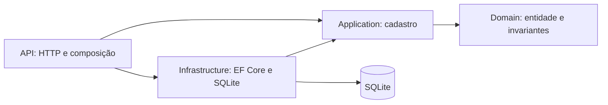

# Autocadastro de motoristas

API REST para a primeira etapa de uma plataforma logística: o próprio motorista informa
seus dados e realiza o cadastro. O único endpoint de negócio é `POST /api/v1/drivers`.
Não há consulta, alteração ou exclusão de motoristas.

## Tecnologias e arquitetura

.NET 10, C# 14, ASP.NET Core Minimal APIs, EF Core, SQLite, OpenAPI e xUnit v3 com VSTest.
O SDK é fixado em `global.json`. Pacotes têm versões explícitas nos projetos e o comando
`dotnet ef` tem manifesto local, sem exigir instalação global.



| Camada | Responsabilidade |
| --- | --- |
| Domain | Entidade `Driver`, validação e normalização; sem dependências de frameworks externos. |
| Application | Caso de uso `RegisterDriver`, resultado e contratos de persistência e data civil; referencia apenas Domain. |
| Infrastructure | `DriverDbContext`, repositório, índices únicos, restrições e migrations. |
| API | Contratos HTTP, composição de dependências, relógio, OpenAPI e tradução de erros. |

Uma entidade encapsulada com fábrica garante as invariantes. Não foram criados Value
Objects para cada string porque o único caso de uso não justifica esse custo. O repositório
tem somente uma operação de inserção; não há repositório genérico, MediatR, AutoMapper,
mensageria ou camadas adicionais. O `DbContext` tem duração por requisição.

## Pré-requisitos e execução

Instale o SDK **.NET 10.0.301** (ou patch compatível da mesma faixa, conforme `global.json`)
e Git. Não é necessário instalar servidor de banco de dados.

Na raiz do repositório:

```sh
dotnet restore DriverRegistration.slnx
dotnet build DriverRegistration.slnx -c Release --no-restore
dotnet test DriverRegistration.slnx -c Release --no-build
dotnet run --project src/DriverRegistration.Api --launch-profile http
```

A API fica em `http://localhost:5080`. O perfil `http` define o ambiente Development e
aplica as migrations na inicialização. O arquivo `drivers.db` é criado no diretório de
conteúdo do projeto API ao usar esse comando. O arquivo de execução não é versionado.
O contrato OpenAPI fica em `http://localhost:5080/openapi/v1.json`, somente em Development.

### Migrations e banco em outros ambientes

Em produção, migrations não são executadas automaticamente. Aplique-as explicitamente
antes de iniciar a API, com a mesma conexão usada pela aplicação:

```sh
dotnet tool restore
dotnet ef database update --project src/DriverRegistration.Infrastructure -- "Data Source=drivers.db"
```

O diretório efetivo da ferramenta EF pode ser o projeto de inicialização. Para evitar que API e
ferramenta usem arquivos diferentes, prefira uma conexão com **caminho absoluto** na variável
`ConnectionStrings__Drivers`. A factory de design usa primeiro o argumento depois de `--`,
depois essa variável; sem ambos usa um banco efêmero em memória para geração de migrations.

Exemplo no PowerShell, a partir da raiz:

```powershell
$env:ConnectionStrings__Drivers = "Data Source=$((Join-Path (Get-Location) 'drivers.db'))"
dotnet ef database update --project src/DriverRegistration.Infrastructure
$env:ASPNETCORE_ENVIRONMENT = 'Production'
dotnet run --project src/DriverRegistration.Api --no-launch-profile -- --urls http://localhost:5080
```

Para criar uma nova migration após uma alteração de modelo:

```sh
dotnet ef migrations add NomeDaAlteracao --project src/DriverRegistration.Infrastructure
dotnet ef migrations has-pending-model-changes --project src/DriverRegistration.Infrastructure
dotnet ef migrations script --project src/DriverRegistration.Infrastructure --output artifacts/schema.sql
```

Crie `artifacts` antes do último comando. O SQLite não suporta o script idempotente do EF;
use `database update` para aplicar apenas migrations pendentes. Revise migrations antes
de aplicá-las a dados que precisam ser preservados.

## Contrato HTTP

Todos os campos abaixo são obrigatórios. Strings não podem ser vazias. A data é civil,
no formato `yyyy-MM-dd`, sem hora ou deslocamento de fuso.

Exemplo com dados sintéticos apenas para teste local:

```json
{
  "name": "Motorista de Teste",
  "cpf": "529.982.247-25",
  "phone": "+55 (31) 99999-9999",
  "email": "motorista@example.com",
  "cnhNumber": "12345678901",
  "cnhCategory": "D",
  "cnhExpirationDate": "2029-12-31"
}
```

O arquivo `examples/register-driver.http` contém uma requisição pronta para clientes HTTP
de IDE. Também é possível salvar o JSON e enviar com:

```sh
curl -i http://localhost:5080/api/v1/drivers -H "Content-Type: application/json" --data-binary @examples/driver.json
```

No Windows PowerShell, use `curl.exe` quando `curl` for um alias. Atualize a validade do
exemplo caso a data já tenha passado. Repetir o mesmo cadastro retorna conflito.

**201 Created** — sem `Location`, pois não existe endpoint de consulta:

```json
{
  "id": "34158fb0-3878-4d73-bcfe-a51d785aa9de",
  "message": "Motorista cadastrado com sucesso."
}
```

**400 Bad Request** — `application/problem+json`, erros por campo:

```json
{
  "type": "https://tools.ietf.org/html/rfc9110#section-15.5.1",
  "title": "Dados de cadastro inválidos.",
  "status": 400,
  "errors": { "cpf": ["Informe um CPF válido."] },
  "code": "validation_error",
  "traceId": "identificador-da-requisicao"
}
```

JSON malformado, tipos incorretos e datas não interpretáveis também retornam 400, com
`errors.body`. Dados de negócio inválidos usam os nomes dos campos em camelCase.

**409 Conflict** — não identifica qual dado único já foi registrado:

```json
{
  "title": "Conflito de cadastro.",
  "status": 409,
  "detail": "Já existe um cadastro com um ou mais dos dados únicos informados.",
  "code": "driver_conflict",
  "traceId": "identificador-da-requisicao"
}
```

**500 Internal Server Error** — `code: internal_error`, mensagem genérica, sem stack trace
ou dados pessoais. Falhas inesperadas do banco não são convertidas em conflitos.
Conteúdo diferente de JSON retorna **415**, `code: unsupported_media_type`.

## Regras de negócio

| Campo | Regra e normalização |
| --- | --- |
| Nome | Entre 2 e 200 caracteres Unicode após remover espaços externos e condensar espaços internos; rejeita controles remanescentes. Aceita acentos, apóstrofos, nomes compostos e nomes únicos; não exige sobrenome. |
| CPF | 11 dígitos ASCII ou máscara `000.000.000-00`; valida verificadores e rejeita dígitos repetidos. Persiste apenas dígitos, com índice único. |
| Telefone | DDD brasileiro da lista de códigos aceitos + 8 dígitos (fixo iniciado em 2–5) ou 9 dígitos (celular iniciado em 9). Aceita parênteses, hífen e prefixo `+55`. Persiste 10 ou 11 dígitos nacionais, sem prefixo internacional. Não valida existência ou titularidade. |
| E-mail | Até 254 caracteres, formato validado por `MailAddress`, sem nome de exibição ou espaços; trim e minúsculas invariantes. Unicidade considera a forma normalizada. A decisão de ignorar caixa também na parte local é uma regra do produto. |
| CNH | Exatamente 11 dígitos ASCII; rejeita sequências de dígitos iguais. Índice único. Não verifica dígitos verificadores nem autenticidade em base oficial. |
| Categoria | A, B, C, D, E, AB, AC, AD ou AE; trim e maiúsculas. Não inclui ACC, que é autorização distinta de categoria de CNH. |
| Validade | Estritamente posterior ao dia atual em `America/Sao_Paulo`; hoje é inválido. `DateOnly` evita deslocamento da data recebida. `TimeProvider` permite testes determinísticos. |

DDDs aceitos: 11–19, 21, 22, 24, 27, 28, 31–35, 37, 38, 41–49, 51, 53–55,
61–69, 71, 73–75, 77, 79, 81–89 e 91–99. Não é feita consulta a cadastro telefônico.

### Integridade, concorrência e privacidade

A inserção é tentada diretamente e a restrição de unicidade do SQLite é a autoridade
final para CPF, e-mail e CNH. Não existe a janela de corrida de uma pré-consulta seguida
de inserção. Violações dos índices de cadastro são traduzidas em 409; outras falhas
continuam no caminho de erro inesperado. O banco também possui restrições básicas de
formato e comprimento, além das invariantes completas do domínio.

Respostas de sucesso contêm somente ID e mensagem. As mensagens de validação não repetem
valores recebidos. Logs de erro da API incluem tipo da exceção e identificador de rastreio,
sem mensagem interna, stack trace ou payload; diagnósticos automáticos dessas exceções
são suprimidos. Logs EF com exceções de comandos/persistência são desativados para evitar
vazamento indireto de valores. Não habilite logs de corpo HTTP ou dados sensíveis do EF.

## Testes e integração contínua

```sh
dotnet test DriverRegistration.slnx -c Release
dotnet test tests/DriverRegistration.UnitTests -c Release
dotnet test tests/DriverRegistration.IntegrationTests -c Release
```

Unitários validam invariantes, normalização e resultados do caso de uso. Integração utiliza
`WebApplicationFactory`, SQLite relacional e migrations reais, com isolamento entre testes.
Não é usado o provider EF InMemory. Os testes não dependem da data do computador.
O workflow em `.github/workflows/ci.yml` restaura, compila e executa a suíte em Linux e Windows.

## Limitações e evoluções

- Prova técnica de autocadastro: sem autenticação, confirmação de e-mail/SMS, consulta oficial
  de documentos ou comprovação de titularidade. Um CPF matematicamente válido não comprova identidade.
- O perfil HTTP é para execução local. Uma implantação pública exige HTTPS no servidor ou
  proxy, configuração de `AllowedHosts`, controle de abuso e uma política de privacidade/retenção.
- SQLite persiste dados pessoais em texto claro. Proteja arquivo e backups com permissões
  e criptografia de disco; não há criptografia de campos nesta entrega.
- SQLite admite apenas um escritor por vez. Unicidade é protegida, mas alto volume pode
  exigir outro banco; falhas de bloqueio não são disfarçadas como duplicidade.
- Não há semântica de idempotência por chave: repetir uma requisição concluída retorna 409.
- O tratamento genérico de conflito reduz detalhes expostos, mas o endpoint público ainda
  pode permitir inferências por tentativas; controle de abuso é uma evolução de implantação.

